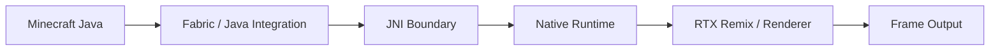

# Pathmine

Path-traced Minecraft Java runtime powered by NVIDIA RTX Remix.

[](LICENSE)
[](#)
[](#)
[](#)

Pathmine preserves NVIDIA's renderer and Minecraft scene capture while adding a native Linux runtime for Minecraft Java. The project targets Minecraft Java 1.21.1 with Fabric and focuses on a native Linux port of the RTX Remix runtime.

> Experimental project. Not an official NVIDIA release.

## Overview

Pathmine combines a Java-side Minecraft integration layer with a native runtime and renderer stack that is closer to the original RTX Remix pipeline. The goal is to preserve the visual model of RTX Remix while enabling a Linux-native execution path for Minecraft Java.

The repository contains:

- Java-side integration and game logic
- JNI bridge and runtime access layer
- native runtime and renderer sources
- packaging and developer tooling
- validation and repository checks

## Architecture



## Scope and limitations

- Target: Minecraft Java 1.21.1 + Fabric
- Linux x86_64 runtime is experimental
- Windows remains the reference platform for visual comparison
- Other versions and loaders are future work
- Full parity, runtime stability, and broad hardware compatibility are still under validation

## Features

- RTX Remix rendering pipeline integration
- Java + native runtime bridge
- Linux runtime port
- Windows and Linux packaging workflows
- Native validation and developer tooling
- Dependency pinning and runtime staging workflow

## Quick start

### Install

1. Download the latest release from [GitHub Releases](https://github.com/EyeCrasher07/Pathmine/releases)
2. Install Fabric for Minecraft Java 1.21.1
3. Install the matching Fabric API
4. Place both JARs in your instance's `mods/` directory

### Build

```bash
git clone --recurse-submodules https://github.com/EyeCrasher07/Pathmine.git
cd Pathmine
./gradlew build testNativeLinux64 -Parch=linux64
```

### Windows build

```powershell
.\gradlew.bat build test
.\gradlew.bat package -Parch=win64
```

## Repository layout

```text
Pathmine/
├── src/                # Minecraft integration and JVM tests
├── rtxremix-java/      # Java API facade and JNI bridge
├── runtime/            # Renderer sources, native tests, and runtime code
├── tools/              # Developer tools, checks, automation, and launch helpers
├── docs/               # User and developer documentation
├── packman/            # Runtime and dependency pins
├── packaging/          # Packaging, defaults, profiles, and licenses
├── gradle/             # Gradle wrapper configuration
├── build.gradle        # Root project build file
├── settings.gradle     # Gradle settings
├── LICENSE             # GPL-3.0 project license
├── NOTICE              # Notice file
├── THIRD_PARTY_NOTICES.md
├── README.md
├── CONTRIBUTING.md
├── AGENTS.md
├── .gitmodules
├── .gitignore
├── .gitattributes
└── docs/
```

## Development

```bash
python3 tools/check_repository.py
./gradlew build testNativeLinux64 -Parch=linux64
uv run --locked --project tools rtx check --tests
```

Additional developer and runtime details:

- [runtime/native/README.md](runtime/native/README.md)
- [docs/GETTING_STARTED.md](docs/GETTING_STARTED.md)
- [docs/NATIVE_LINUX_PORT.md](docs/NATIVE_LINUX_PORT.md)

## Documentation

- [Playing and troubleshooting](docs/PLAYING.md)
- [Getting started with the developer tools](docs/GETTING_STARTED.md)
- [Settings](docs/SETTINGS.md)
- [Commands and controls](docs/IN_GAME_GUIDE.md)
- [Resource packs](docs/RESOURCE_PACKS.md)
- [Camera paths](docs/CAMERA_PATHS.md)
- [Contributing](CONTRIBUTING.md)

## License

This project is licensed under GPL-3.0, while upstream components retain their own applicable licenses. See:

- [LICENSE](LICENSE)
- [NOTICE](NOTICE)
- [THIRD_PARTY_NOTICES.md](THIRD_PARTY_NOTICES.md)
- [LICENSES/Apache-2.0.txt](LICENSES/Apache-2.0.txt)
- [runtime/LICENSE](runtime/LICENSE)

---

NOT AN OFFICIAL MINECRAFT PRODUCT. NOT APPROVED BY OR ASSOCIATED WITH MOJANG OR MICROSOFT.
